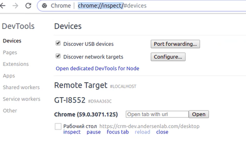

# Google Chrome

## Команды

```bash
Ctrl + F5         # Перезагрузка без кэша
Ctrl +            # Увеличение шрифта консоли
Ctrl + R          # Перезагрузка
Ctrl + Shift + R  # Жесткая перезагрузка
```

## Закладки

```bash
%LOCALAPPDATA%\Google\Chrome\User Data\Default
C:\Users\User\AppData\Local\Google\Chrome\User Data\Default
```

- Bookmarks (текущая версия)
- Bookmarks.bak (бэкап)

## Экспериментальные возможности

```bash
chrome://flags
```

- _Reading List_ - список для чтения
- _Experimental Web Platform features_ - возможности веб-платформы, которые ещё в разработке и не включены по умолчанию

::: warning

- CSS `@apply` раньше включался этим флагом, но из Chrome его убрали: в 2017 году от предложения отказались. Для стилизации элементов внутри Shadow DOM вместо него используется `::part()`

:::

## Chrome: Мобильная версия

- Телефон -> Режим разработки
- О телефоне -> Версия ПО -> Отладка по USB


