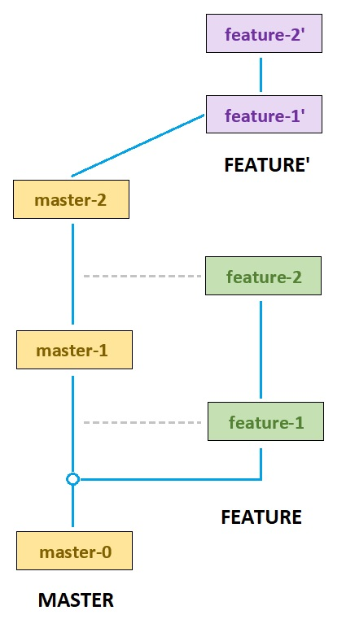

# `git rebase`

## Информация

::: danger

**`git rebase`** - позволяет взять все коммиты из одной ветки и применить их поверх другой

:::

- Выполняет работу аналогичную cherry-pick, только для цепочки коммитов, перенося ветку на новое место
- Коммит, который не даёт изменений, называется пустым. rebase автоматически пропускает этот коммит

## Команды

### Rebase

```bash
git rebase develop    # rebase
git rebase --continue # Продолжить rebase (вызывается при наличии конфликтов)
git rebase --skip     # Пропустить коммит (вызывается при наличии конфликтов)
git rebase --abort    # Отказаться от rebase (возвращает обратно HEAD - не изменит историю коммитов)
git rebase --quit     # Отказаться от rebase (НЕ возвращает обратно HEAD - HEAD остаётся там, где rebase был прерван)
```

::: details --continue

- Флаг `--continue` позволяет продолжить rebase после фикса конфликта и перейти к следующему коммиту

```bash
# Rebase develop в текущую ветку
git rebase develop

# Если есть конфликт, rebase останавливается на этом коммите: нужно поправить конфликт в файлах
# После фикса добавляются изменения в staged
git add .

# Продолжить Rebase и перейти к следующему коммиту
git rebase --continue

# Откроется редактор, где можно изменить название коммита
# После закрытия редактора Rebase перейдет к следующему коммиту
# Если следующего коммита нет, то Rebase завершится
```

:::

::: details --skip

- Флаг `--skip` позволяет пропустить коммит из текущей ветки и взять изменения из _develop_

```bash
# Rebase develop в текущую ветку
git rebase develop

# Если есть конфликт, rebase останавливается на этом коммите
# Пропустить коммит из текущей ветки и перейти к следующему коммиту
git rebase --skip
```

:::

::: details --abort

- Флаг `--abort` позволяет вернуть состояние текущей ветки до rebase
- Маркер HEAD будет перенесен обратно на текущую ветку, а уже добавленные коммиты повиснут в воздухе (на них не будет указывать ни один указатель) и будут вскоре удалены

```bash
# Rebase develop в текущую ветку
git rebase develop

# Если есть конфликт, rebase останавливается на этом коммите
# Откатиться в состояние до rebase
git rebase --abort
```

:::

### Интерактивный Rebase

```bash
git rebase -i develop # Интерактивный rebase на другую ветку
git rebase -i HEAD~3  # Интерактивный rebase внутри ветки (изменить историю последних 3х коммитов)
```

- При интерактивном rebase можно работать только с новыми коммитами, добавленными для текущей ветки. Пример: при _git rebase -i master_ в ветку _feature_, в окне интерактивного rebase будут отражены коммиты только для _feature_
- В начале rebase запустится окно редактора, где можно указать определенную команду для каждого коммита
- При этом переписывается история коммитов - у каждого коммита будет новый хэш

```bash
pick  cb923a7 MessageCommit1
fixup 0a101a7 MessageCommit2
fixup 67e7534 MessageCommit3
```

#### Команды

- `pick` (`p`) - использовать коммит без изменений (по умолчанию)
- `reword` (`r`) - использовать текущий коммит с возможностью изменения сообщения коммита
- `drop` (`d`) - удаление коммита (вместо этого можно удалить строку с коммитом)
- `fixup` (`f`) - будет объединен с предыдущим коммитом в списке, но без изменения сообщения коммита

---

- `squash` (`s`) - будет объединен с предыдущим коммитом в списке
- `edit` (`e`) - отредактировать коммит (когда git дойдёт до коммита, выполнится остановка и git предложит выполнить действия)
- `exec` (`x`) - выполнить скрипт для указанного коммита
- `break` (`b`) - остановиться здесь (продолжить rebase позже с _git rebase --continue_)
- `label` (`l`) - добавить метку для текущего HEAD с заданным именем
- `reset` (`t`) - сбросить HEAD до указанной метки
- `merge` (`m`) - создать merge-commit, используя message исходного merge-commit (или однострочный, если исходный merge-commit не был указан)

## Алгоритм работы

Задача: загрузить изменения из _master_ в _feature_

<v-two text-left>
<template #first>

**Подготовка:** Создание ветки _feature_ и добавление коммитов в _master_ и _feature_

- _feature_ откалывается от _master_
- В каждую ветку поочередно добавляются коммиты

**Порядок коммитов**

1. `master-0` - master
2. `feature-1` - feature
3. `master-1` - master
4. `feature-2` - feature
5. `master-2` - master

**1. Rebase:** Создание новой ветки _feature'_

- Создается новая временная ветка _feature'_ на основе актуального состояния _master_

**2. Rebase:** Копирование всех коммитов _feature_ поверх текущей вершины _master_ для временной ветки _feature'_

- Работает аналогично cherry-pick: последовательно берутся изменения каждого коммита из _feature_ и применяются к вершине _master_: для каждого из коммитов в _feature_ берётся его дельта и сохраняется во временный файл
- Из каждого временного файла создается новый коммит с тем же автором и описанием, но другим хэшем

**3. Rebase:** Перенос HEAD из ветки _feature_ в ветку _feature'_

- После копирования коммитов ссылка _feature_ переносится на вершину новосозданной ветки _feature'_
- Теперь ветка _feature'_ (копия ветки _feature_) основана на последнем состоянии _master_

</template>
<template #last>



</template>
</v-two>

## Плюсы и минусы

<v-two text :title="['Минусы', 'Плюсы']">
<template #first>

- При rebase меняется история: меняются все хэши коммитов
- Если над веткой работает несколько человек и был rebase, то остальные разработчики не смогут нормально сделать pull, при условии наличия локальных коммитов. Пойдут конфликты. Рекомендуется, если над веткой работает 1 человек
- По истории нельзя будет посмотреть, в какие моменты происходило обновление ветки

</template>
<template #last>

- Красивая и понятная история
- Не появляется лишних коммитов, в отличие от merge-коммитов

</template>
</v-two>

## Примеры

::: details Актуализация ветки через rebase

- Есть 2 ветки: _develop_ и _feature_
- Необходимо актуализировать ветку _feature_: подтянуть последние изменения из _develop_ и решить конфликты, если они есть

```bash
# Шаг 1
git checkout develop   # Перейти в ветку develop
git fetch origin       # Подтянуть последние изменения для develop
git pull               # Взять последние изменения для develop
git checkout feature   # Перейти в ветку feature
```

- На выбор: делать _rebase_ на ветку локального или удаленного репозитория
- Если делать _rebase_ с _origin/develop_, то нет необходимости делать _git pull_

```bash
# Шаг 2
git rebase -i develop        # Взять последние изменения из develop
git rebase -i origin/develop # Взять последние изменения из origin/develop
```

- Если есть конфликты, rebase остановится на коммите с конфликтом
- Пофиксить конфликты

```bash
# Шаг 3
git add .             # Добавить измененные файлы в staged
git rebase --continue # Если несколько коммитов, то переходим к фиксу следующего коммита
```

- Если есть конфликт, то его нужно фиксить в каждом коммите
- После фикса всех коммитов и добавления в _staged_ (через git add), Working Tree будет чистое: не нужно ничего коммитить

```bash
# Шаг 4
git push origin HEAD # Отправка изменений на удаленный репозиторий
```

- Rebase изменяет историю коммитов и указатель, поэтому, если сначала сделать _git push_, а потом _git rebase_ на локальном репозитории, то повторный push придется делать через _push --force_
- При использовании _push --force_ сервер перепишет историю в ветке, которая будет повторять историю локальной ветки

```bash
# Шаг 4
git push --force origin HEAD # Отправка изменений на удаленный репозиторий
```

:::
