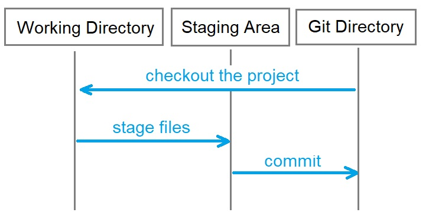
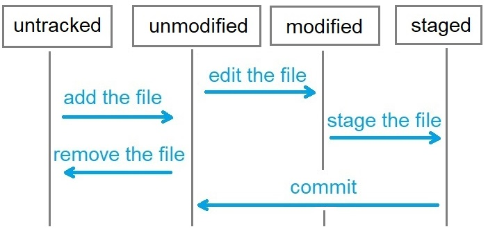

# Принцип работы

## Указатели

::: tip Определение

- **HEAD** - ссылка на последний коммит и на текущую ветку
- **Branch** - ветка-указатель на коммит. На один коммит может быть несколько веток-указателей (н-р, сразу после создания новой ветки)
- **remotes/origin/master** - указатель, показывающий, на каком коммите находится указатель ветки в удаленном репозитории. Ветки слежения удаленного репозитория

:::

- Локально _origin_ нет

## Статусы

1. **Untracked** - после добавления нового файла
2. **Staged** - после _git add_
3. **Modified** - после изменения существующего файла
4. **Committed** - после _git commit_

## Правила

- Каждый коммит ссылается на предыдущий. В качестве ссылки выступает хэш-сумма коммита

## Local Operation

- **I. Working Directory** - рабочий каталог
- **II. Staging Area** - область подготовленных файлов
- **III. Git Directory (Repository)** - каталог git

**Этапы**

1. Внесение изменений в файлы рабочего каталога
2. Подготовка файлов: добавление их слепков в область Staging Area
3. `commit` - берет подготовленные файлы из индекса Staging Area и помещает их в Git Directory на постоянное хранение

## File Status Lifecycle

- Файл в Working Directory может находиться под версионным контролем (_unmodified, modified, staged_) или быть неотслеживаемым (_untracked_)
