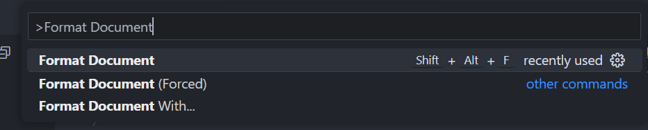
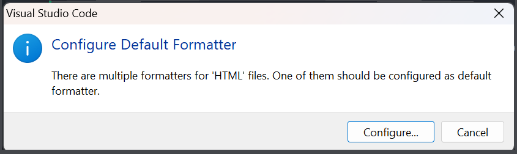
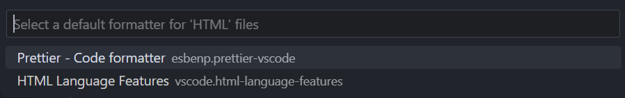
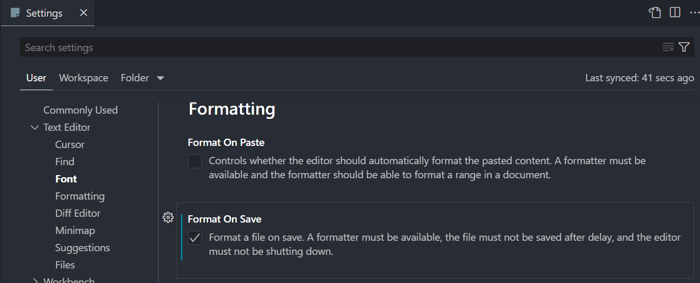

# Плагин для VSCode

## Информация

::: info

- https://marketplace.visualstudio.com/items?itemName=esbenp.prettier-vscode - Prettier - Code formatter

:::

## 1. Установка плагина

<v-breadcrumbs :items="['Extensions', 'Prettier - Code formatter', 'Install', 'Reload']" />

## 2. Настройка плагина для определенных файлов

<v-breadcrumbs :items="['View', 'Command Palette...']" />

<v-breadcrumbs keys :items="['Ctrl', 'Shift', 'P']" text="или сочетание клавиш" />

- Ввести "Format Document"

- Выбрать "Configure..."

- Выбрать "Prettier - Code formatter"

- В примере Prettier будет применяться ко всем файлам HTML во всех проектах

## 3. Применение Prettier при сохранении файла

<v-breadcrumbs :items="['File', 'Preferences', 'Settings']" />

<v-breadcrumbs :items="['Text Editor', 'Formatting', 'Format On Save (checked)']" />

## 4. Стандартный конфиг Prettier в VSCode

- Если в проекте есть файл _.prettierrc.json_, то конфиги будут браться из него, а не из настроек VSCode

<v-breadcrumbs :items="['File', 'Preferences', 'Settings']" />

<v-breadcrumbs :items="['Extensions', 'Prettier']" />
