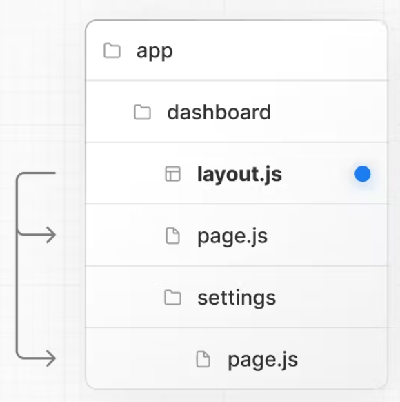

# Layouts

## Информация

::: info

- https://nextjs.org/docs/app/building-your-application/routing/pages-and-layouts

:::

## Root Layout

::: tip Определение

- **Root Layout** - главный обязательный Layout для всех страниц приложения

:::

- Позволяет изменять исходный HTML-код, возвращаемый с сервера
- Должен определять теги `<html>` и `<body>`, т.к. Next.js не создает их автоматически
- Сам _RootLayout_ явно не вызывается. Привязка происходит под капотом

```jsx
// app/layout.jsx
export const metadata = {
  title: "Название проекта",
  description: "Описание проекта",
};

const RootLayout = (props) => {
  const { children } = props;

  return (
    <html lang="en">
      <body>{children}</body>
    </html>
  );
};

export default RootLayout;
```

### Metadata

::: info

- https://nextjs.org/docs/app/building-your-application/optimizing/metadata

:::

- Используется для определения метаданных приложения: meta, link тегов внутри HTML, head элементов
- При использовании обоих этих вариантов Next.js автоматически сгенерирует соответствующие `<head>` элементы для страниц
- Метаданные могут быть статические (объявление объекта) и динамические (объявление функции)

```js
// Явно в коде не вызывается - всё происходит под капотом
export const metadata = {
  title: "Название проекта",
  description: "Описание проекта",
};
```

## Layout для страницы

- Любая страница может определить собственный Layout. Для этого нужно добавить _layout.js_ рядом с _page.js_ (в примере страница _Dashboard_)
- В константу _metadata_ также можно добавить метаинформацию
- Явно _DashboardLayout_ вызывать не нужно - он автоматически подключится к странице



```jsx
// app/dashboard/layout.jsx
export const metadata = {
  title: "Новый заголовок",
  description: "Новое описание",
};

const DashboardLayout = (props) => {
  const { children } = props;

  return (
    <section>
      {/* Include shared UI here e.g. a header or sidebar */}
      <nav>Navbar</nav>
      {children}
    </section>
  );
};

export default DashboardLayout;
```
