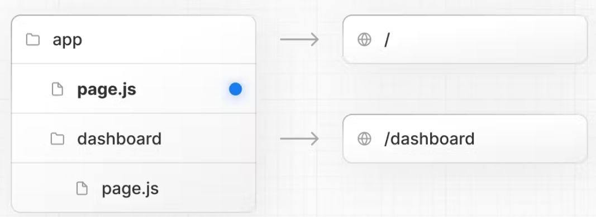

# Pages

## Информация

::: info

- https://nextjs.org/docs/app/building-your-application/routing/pages-and-layouts

:::

- Next.js ищет имя _page.js_ в директории _app_ для формирования роутов



```tsx
// `app/page.tsx` is the UI for the `/` URL
export default function Page() {
  return <h1>Hello, Home page!</h1>;
}
```

```tsx
// `app/dashboard/page.tsx` is the UI for the `/dashboard` URL
export default function Page() {
  return <h1>Hello, Dashboard Page!</h1>;
}
```

## Использование _Pages Router_

::: info

- https://nextjs.org/docs/getting-started/installation#the-pages-directory-optional

:::

::: warning

- В Next.js поддерживается предыдущая версия роутинга, когда страницу можно размещать в директории _pages_
- Для таких страниц будет недоступен _Root Layout_ и нужно будет создавать собственный, которым нужно обернуть компонент
- Если в собственном Layout использовать тег `<html>`, то будет ошибка

:::

### Пример для страницы Dashboard

- Next.js увидит, что в директории _"pages"_ есть директория _"dashboard"_ и создаст роут _/dashboard_

::: code-group

```jsx [pages/dashboard/index.jsx]
import LayoutDashboard from "../../layouts/LayoutDashboard";

const DashboardPage = () => {
  return (
    <LayoutDashboard>
      <h1>Dashboard</h1>
    </LayoutDashboard>
  );
};

export default DashboardPage;
```

```jsx [layouts/LayoutDashboard.jsx]
import Head from "next/head";

const LayoutDashboard = (props) => {
  const { children } = props;

  return (
    <>
      <Head>
        <title>Название</title>
        <meta name="description" content="Описание"></meta>
      </Head>
      <main>{children}</main>
    </>
  );
};

export default LayoutDashboard;
```

:::
