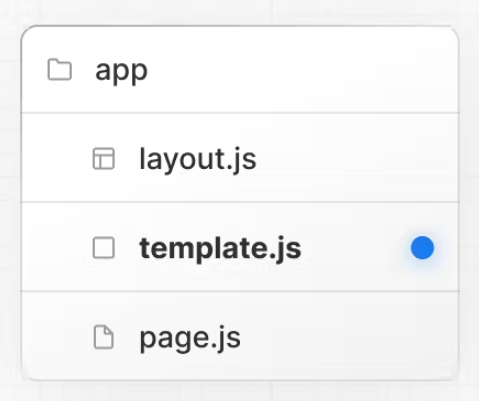

# Templates

## Информация

- Шаблоны похожи на макеты в том, что они оборачивают каждый дочерний макет или страницу
- В отличие от макетов, которые сохраняются на всех маршрутах и сохраняют состояние, шаблоны создают новый экземпляр для каждого из своих дочерних элементов при навигации. Это означает, что когда пользователь перемещается между маршрутами, имеющими общий шаблон, монтируется новый экземпляр компонента, элементы DOM воссоздаются, состояние не сохраняется, а эффекты повторно синхронизируются
- Шаблон можно определить путем экспорта компонента React по умолчанию из файла template.js. Компонент должен принимать _children_ реквизит



```jsx
export default function Template({ children }) {
  return <div>{children}</div>;
}
```

- С точки зрения вложенности, template.js отображается между макетом и его дочерними элементами. Вот упрощенный вывод:

```jsx
<Layout>
  {/* Note that the template is given a unique key. */}
  <Template key={routeParam}>{children}</Template>
</Layout>
```
