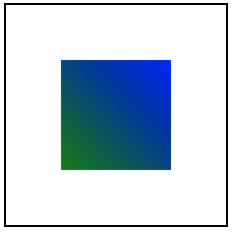

# Gradient

## Элемент

<v-two fix-right>
<template #first>

```js
const grad = ctx.createLinearGradient(0, 100, 100, 0);
grad.addColorStop(0, "green");
grad.addColorStop(1, "blue");
ctx.fillStyle = grad;
ctx.fillRect(50, 50, 100, 100);
```

</template>
<template #last>



</template>
</v-two>
