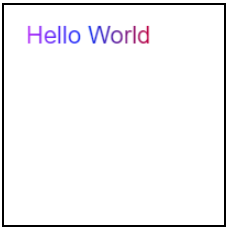

# Text Gradient

## Элемент

<v-two fix-right>
<template #first>

```js
const grad = ctx.createLinearGradient(0, 0, 150, 0);
grad.addColorStop(0, "magenta");
grad.addColorStop(0.5, "blue");
grad.addColorStop(1, "red");
ctx.fillStyle = grad;

ctx.font = "22px Arial";
ctx.fillText("Hello World", 20, 35);
```

</template>
<template #last>



</template>
</v-two>
