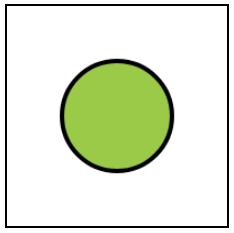

# Arc

<v-two>
<template #first>

```js
ctx.beginPath();
ctx.arc(100, 100, 50, 0, Math.PI * 2, false);
ctx.closePath();
ctx.fill(); // fill
ctx.stroke(); // stroke
```

</template>
<template #last>



</template>
</v-two>

```js
arc();
1 - координаты центра окружности (x)
2 - координаты центра окружности (y)
3 - радиус
4 - start angle (справа)
5 - end angle (360deg = pi*2)
6 - рисование по часовой (false) / против (true) часовой стрелки
```
