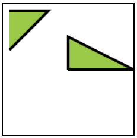

# Line, Path

## Элемент

<v-two fix-right>
<template #first>

```js
ctx.beginPath();

ctx.moveTo(100, 100);
ctx.lineTo(100, 50);
ctx.lineTo(200, 100);
ctx.closePath();

ctx.moveTo(10, 10);
ctx.lineTo(70, 10);
ctx.lineTo(10, 70);

ctx.fill();
ctx.stroke();
```

</template>
<template #last>



</template>
</v-two>
