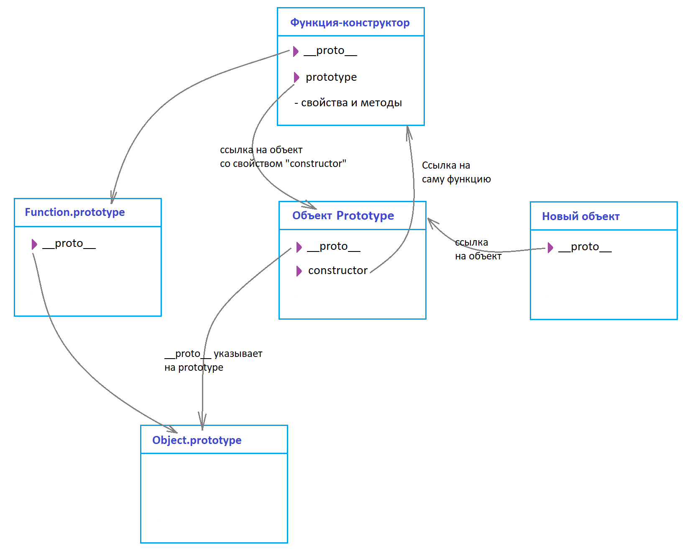
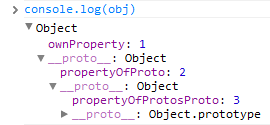
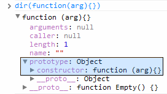
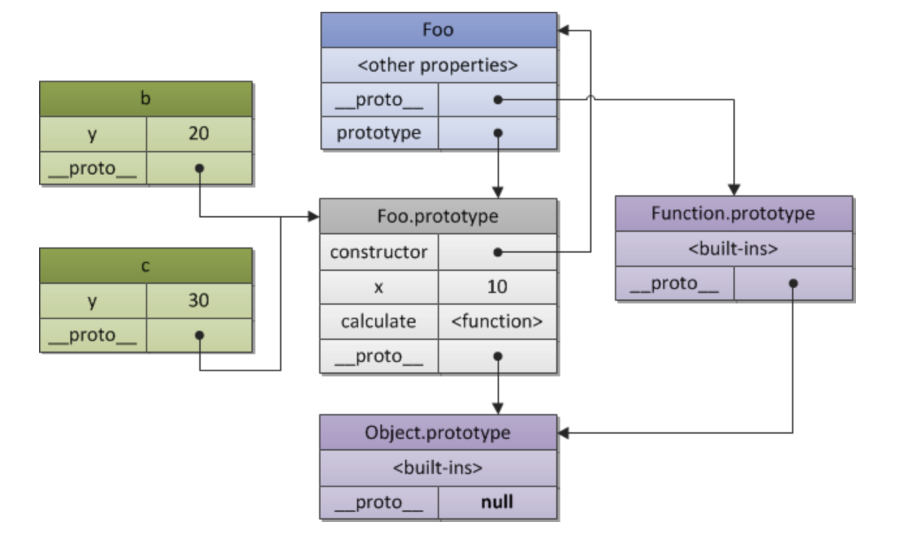
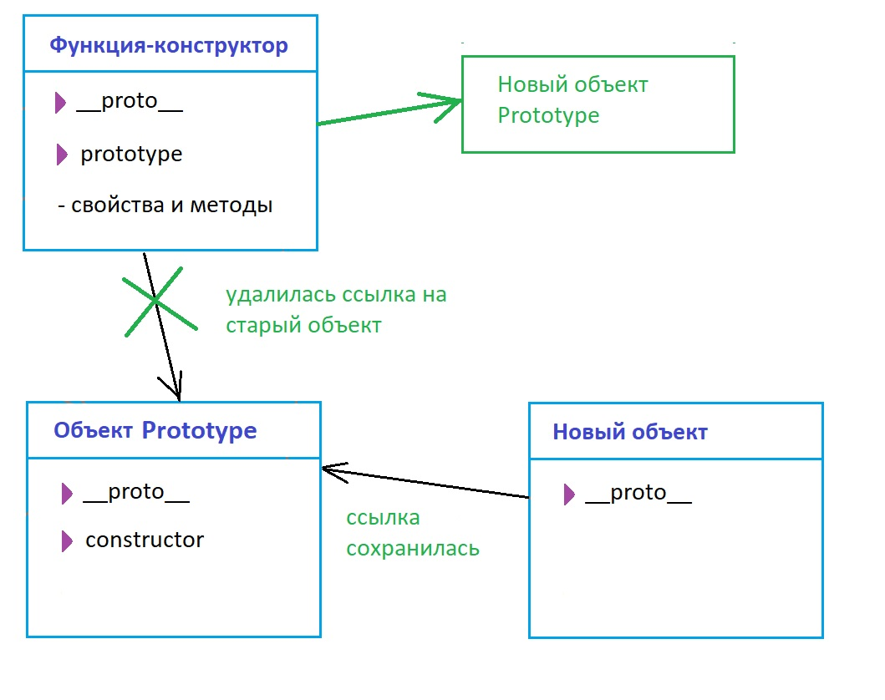
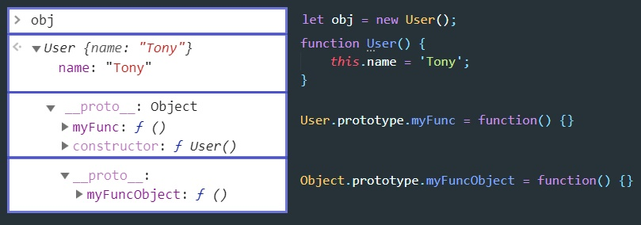

# `__proto__` и prototype

## Информация

::: info

- https://dev.to/lydiahallie/javascript-visualized-prototypal-inheritance-47co - JavaScript Visualized: Prototypal Inheritance

:::

<v-two>
<template #first>

::: tip Определение

- **`__proto__`** - свойство _объекта_ `Object.prototype`, хранящее ссылку на свойство `prototype` конструктора

---

- **prototype** - свойство _функции_ с единственным свойством `constructor`, которое ссылается на саму функцию
- **Используется:** как прототип при создании новых объектов оператором `new`
- **Цель:** указывать `__proto__` для новых объектов. При создании объекта через `new`, в его прототип `__proto__` записывается ссылка из `prototype` функции-конструктора

---

- **constructor** - свойство, ссылающееся на саму функцию

:::

</template>
<template #last>



</template>
</v-two>

## `__proto__`

- При обращении к любому свойству объекта, оно в первую очередь ищется в самом объекте. Но если его там нет, поиск происходит в свойстве `__proto__`. Если его нет и там, оно ищется дальше по цепочке (_prototype chain_)
- `__proto__` - наследование на уровне объектов



## prototype



- _Прототип_ - ссылка на другой объект, предоставляющий методы и свойства
- Есть у каждой функции, кроме стрелочной
- Имеет смысл только у _конструктора_, когда есть вызов `new`
- Значением prototype может быть только объект

## Схемы



## Примеры

### 1. Перетирание прототипа

- При создании объекта его `__proto__` 1 раз получает ссылку на `prototype` функции конструктора
- Эта ссылка остаётся при `Fn.prototype = {};` и по-прежнему указывает на старое значение, но к функции конструктору уже не имеет отношения
- При `Fn.prototype = {}` не просто добавили объект, а поменяли ссылку и новые отнаследованные объекты получат уже ее



<v-two :title="['Всё стандартно', 'Перетирание прототипа']">
<template #first>

```js
function Fn() {}

Fn.prototype = {
  isConnected: true,
};

let connect = new Fn();

console.log(connect.isConnected); // => true

Fn.prototype.isConnected = false;

console.log(connect.isConnected); // => false
```

</template>
<template #last>

```js
function Fn() {}

Fn.prototype = {
  isConnected: true,
};

let connect = new Fn();

console.log(connect.isConnected); // true

Fn.prototype = {};

console.log(connect.isConnected); // true
```

</template>
</v-two>

### 2

```js
function User() {
  this.name = "Tony";
}
function Admin() {
  this.id = 77;
}
Admin.prototype = new User();
// Admin.__proto__ = new User();
const admin = new Admin(); // => Admin {id: 77, __proto__: User name: "Tony"}
```

### 3



```js
function User() {
  this.name = "Tony";
}
User.prototype.myFunc = function () {};
Object.prototype.myFuncObject = function () {};
let obj = new User();
```
