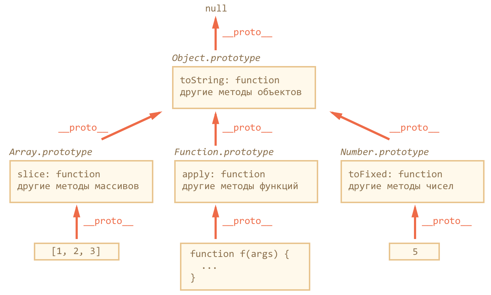

# Теория

## Информация

### Хранение и копирование

- _Примитивные типы данных_ - хранение и копирование _«по значению»_. Передаются копированием значения. В результате копирования получатся две полностью независимые переменные
- Если в функцию отправить число, то будем работать с копией числа: оригинальное число не изменится
- _Объекты_ - хранение и копирование _«по ссылке»_. Передаются копированием ссылки. В переменной, которой присвоен объект, хранится не сам объект, а «адрес его места в памяти», иными словами – «ссылка» на него. При копировании переменной с объектом – копируется эта ссылка, а объект по-прежнему остается в единственном экземпляре. Получили две переменные, в которых находятся ссылки на один и тот же объект
- Если в функцию отправить объект, функция получит ссылку на него, а не копию: при изменении объекта внутри функции изменяется оригинальный объект
