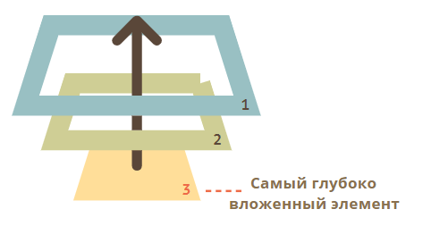

# 3. Фаза всплытия

## Информация

::: tip Определение

- **Всплытие** - когда на элементе происходит событие, обработчики сначала срабатывают на нём, потом на его родителе, затем выше и так далее, вверх по цепочке предков

:::

- События «всплывают» от внутреннего элемента вверх через родителей подобно тому, как всплывает пузырёк воздуха в воде
- Всплытие идёт с «целевого» элемента наверх. По умолчанию событие будет всплывать до элемента html, а затем до объекта document, а иногда даже до window, вызывая все обработчики на своём пути

### Пример

```html
<!-- 3 вложенных элемента FORM > DIV > P с обработчиком на каждом -->
<form onclick="alert('form')">
  FORM
  <div onclick="alert('div')">
    DIV
    <p onclick="alert('p')">P</p>
  </div>
</form>
```

**Клик на `<p>` вызовет обработчик onclick**

1. Сначала на самом `<p>`
2. Потом на внешнем `<div>`
3. Затем на внешнем `<form>`
4. И так далее вверх по цепочке до самого _document_

### Схема



## event.target

- Всегда можно узнать, на каком конкретно элементе произошло событие
- Самый глубокий элемент, который вызывает событие, называется _целевым элементом_ - он доступен через `event.target`

### Отличие event.target от this

- `event.target` – это «целевой» элемент, на котором произошло событие, в процессе всплытия он неизменен
- `this` – это «текущий» элемент, до которого дошло всплытие, на нём сейчас выполняется обработчик
- Возможна и ситуация, когда `event.target` и `this` – один и тот же элемент, например, если клик был непосредственно на самом элементе form, не на его подэлементе

### Пример

- Если стоит только один обработчик _form.onclick_, то он «поймает» все клики внутри формы. Где бы ни был клик внутри - он всплывёт до элемента _form_, на котором сработает обработчик

```html
<form id="form">
  FORM
  <div>
    DIV
    <p>P</p>
  </div>
</form>

<script>
  form.onclick = function (event) {
    event.target.style.backgroundColor = "yellow";
    alert("event.target: " + event.target.tagName);
    alert("this: " + this.tagName);
  };
</script>
```

## Прекращение всплытия

- Всплытие идёт с «целевого» элемента наверх. Любой промежуточный обработчик может решить, что событие полностью обработано, и остановить всплытие
- Если у элемента есть несколько обработчиков на одно событие, то даже при прекращении всплытия все они будут выполнены
- **Недостаток**: при использовании систем аналитики где необходимо учитывать все клики, события с _stopPropagation_ не будут учитываться

::: danger

**`event.stopPropagation()`** - прекращение всплытия, но на текущем элементе все обработчики будут вызваны

:::

::: danger

**`event.stopImmediatePropagation()`** - прекращение всплытия и остановка обработки событий на текущем элементе

:::

```html
<body onclick="alert('Сюда всплытие не дойдёт')">
  <button onclick="event.stopPropagation()">Кнопка</button>
</body>
```
