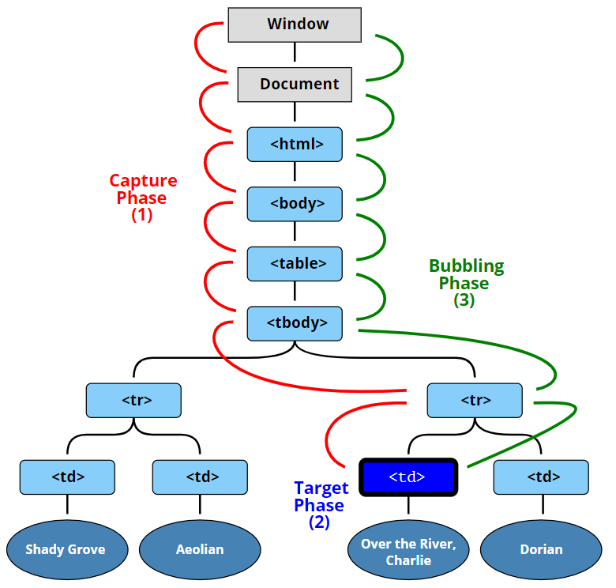
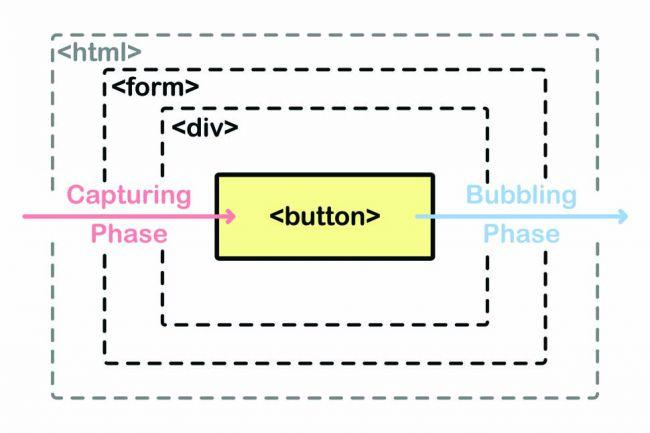

# Модель распространения событий

## Информация

::: info

- https://www.w3.org/TR/DOM-Level-3-Events/ - UI Events

:::

## DOM Events - модель распространения событий

| №   | Фаза                                            | Константа                 | Описание                                                                                      |
| --- | ----------------------------------------------- | ------------------------- | --------------------------------------------------------------------------------------------- |
| 1   | **Фаза погружения/перехвата (Capturing phase)** | `Event.CAPTURING_PHASE=1` | Идет от родительского элемента (_document_ или _window_ в зависимости от события) до целевого |
| 2   | **Фаза цели (Target phase)**                    | `Event.AT_TARGET=2`       | Событие достигло целевого (исходного) элемента                                                |
| 3   | **Фаза всплытия (Bubbling stage)**              | `Event.BUBBLING_PHASE=3`  | Идёт от целевого элемента до родительского (_document_ или _window_)                          |

## Необходимость всплытия и погружения

- Реализация делегирования
- Настройка дефолтных обработчиков

## Алгоритм работы

- При наступлении события – самый глубоко вложенный элемент, на котором оно произошло, помечается как «целевой» `event.target`
- Затем событие сначала двигается вниз от корня документа к event.target, по пути вызывая обработчики, поставленные через `addEventListener(..., {capture: true})`
- Далее обработчики вызываются на целевом элементе
- Далее событие двигается от event.target вверх к корню документа, по пути вызывая обработчики, поставленные через `on<event>` и addEventListener без третьего аргумента или с третьим аргументом равным false

## Схема работы

- На картинке клик по ячейке _td_, расположенной внутри таблицы
- При клике на _td_ событие перемещается по цепочке родителей сначала вниз к элементу (погружается), затем оно достигает целевой элемент (фаза цели), а потом идёт наверх (всплытие), вызывая по пути обработчики

<v-two>
<template #first>



</template>
<template #last>



</template>
</v-two>

## Пример

```html
<form>
  FORM
  <div>
    DIV
    <p>P</p>
  </div>
</form>

<script>
  for (let elem of document.querySelectorAll("*")) {
    elem.addEventListener(
      "click",
      (e) => alert(`Погружение: ${elem.tagName}`),
      true,
    );
    elem.addEventListener("click", (e) => alert(`Всплытие: ${elem.tagName}`));
  }
</script>
```

**Клик на `<p>`**

1. _HTML → BODY → FORM → DIV_ (фаза погружения, первый обработчик)
2. _P_ (фаза цели, срабатывают обработчики, установленные и на погружение и на всплытие, так что выведется два раза)
3. _DIV → FORM → BODY → HTML_ (фаза всплытия, второй обработчик)

## Прочее

- На каждой фазе разные обработчики на одном элементе срабатывают в порядке назначения
- Если несколько обработчиков одного события, назначенных addEventListener на один элемент, в рамках одной фазы, то их порядок срабатывания – тот же, в котором они установлены

```js
element.addEventListener("click", (e) => alert(1)); // Всегда сработает перед следующим
element.addEventListener("click", (e) => alert(2));
```
