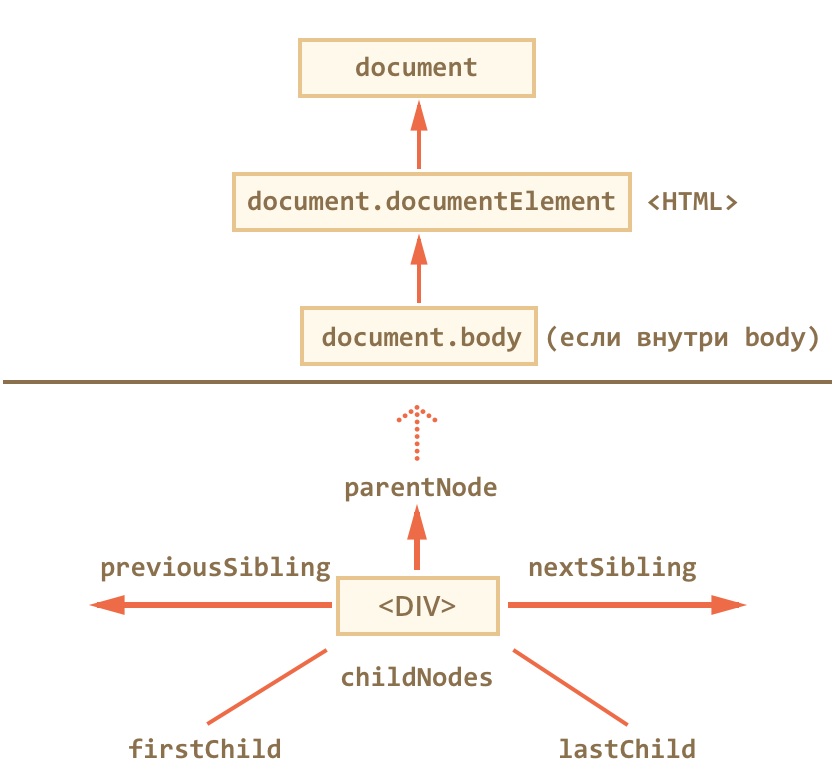
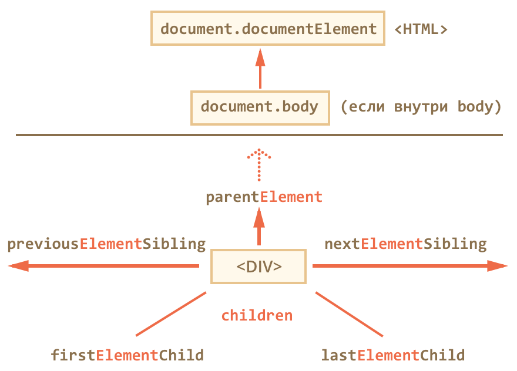

# Выборка элементов страницы

## Информация

<v-two>
<template #first>

**Все узлы, включая текстовые и комментарии**



</template>
<template #last>

**Только узлы-элементы**



</template>
</v-two>

## Корневые элементы

```js
document.documentElement; // Элемент HTML
document.body; // Элемент BODY
document.head; // Элемент HEAD
```

## Родственные элементы

- **Дочерние элементы (дети)** - элементы, которые лежат непосредственно внутри данного
- **Потомки** - все элементы, которые лежат внутри данного, вместе с их детьми, детьми их детей и так далее. То есть, всё поддерево DOM

### Все узлы, включая текстовые и комментарии / Только узлы-элементы

<!-- prettier-ignore -->
```js
elem.parentNode;      elem.parentElement;          // Родитель
elem.childNodes;      elem.children;               // Дочерние элементы
elem.firstChild;      elem.firstElementChild;      // Первый ребенок
elem.lastChild;       elem.lastElementChild;       // Последний ребенок
elem.nextSibling;     elem.nextElementSibling;     // Следующий сосед (брат)
elem.previousSibling; elem.previousElementSibling; // Предыдущий сосед (брат)
```

```js
// Всегда
elem.parentNode == elem.parentElement;
// Кроме исключения
document.documentElement.parentNode; // document
document.documentElement.parentElement; // null

let a = document.childNodes; // Дети с DOCTYPE и комментариями
let a = document.children; // Дети
let a = document.children[0].children[1].children; // Все элементы из BODY
let a = document.body.childNodes[0]; // Первый элемент
```

## Поиск элементов DOM (6 основных методов)

| Метод                    | Ищет по...    | Ищет внутри элемента? |
| ------------------------ | ------------- | --------------------- |
| `getElementById`         | `id`          | -                     |
| `getElementsByName`      | `name`        | -                     |
| `getElementsByTagName`   | тег или `'*'` | ✓                     |
| `getElementsByClassName` | классу        | ✓                     |
| `querySelector`          | CSS-селектор  | ✓                     |
| `querySelectorAll`       | CSS-селектор  | ✓                     |

```js
let a = document.getElementById("item"); // По id
// Браузер поддерживает у себя внутреннее соответствие id -> элемент, поэтому нужный элемент возвращается сразу

let a = document.getElementsByTagName("img"); // По названию тега (все элементы)
let a = document.getElementsByTagName("*"); // Получить все элементы документа
let a = elem.getElementsByTagName("*"); // Получить всех потомков элемента elem

let a = document.getElementsByName("item"); // По атрибуту name

let a = document.getElementsByClassName("item"); // По названию класса
let a = document.getElementsByClassName("item")[0]; // Первый элемент

let a = document.querySelector(".nav.bar"); // Возвращает только первый элемент внутри документа

let a = document.querySelectorAll(".nav"); // Возвращает список элементов в пределах документа
let a = elem.querySelectorAll(css)[0]; // Сначала ищутся все элементы, а потом берётся первый
let a = document.querySelectorAll(":hover"); // Вернёт список, в порядке вложенности, из текущих элементов под курсором мыши
```

- `getElementsBy*(...)` и т.д. возвращают не обычные массивы, а живые коллекции. При изменении документа - изменяется и результат запроса
- Результат запросов getElementsBy* - это не массив, а специальный объект, имеющий тип `NodeList` или `HTMLCollection`. Он похож на массив, так как имеет нумерованные элементы и длину, но внутри это не готовая коллекция, а «живой поисковой запрос»
- Поиск выполняется только при обращении к элементам коллекции или к её длине
- `elem.querySelector(query), elem.querySelectorAll(query)` - браузер перебирает все подэлементы внутри элемента elem (или по всему документу, если вызов в контексте документа) и проверяет каждый элемент на соответствие запросу query
- Вызов querySelector прекращает перебор после первого же найденного элемента, а querySelectorAll собирает найденные элементы в «псевдомассив»: внутреннюю структуру данных, по сути аналогичную массиву JavaScript

## Поиск и проверки

### elem.matches(css)

::: danger

**`elem.matches(css)`** - ничего не ищет, а проверяет, удовлетворяет ли elem селектору css. Бывает полезным, когда мы перебираем элементы (в массиве или по обычным навигационным ссылкам) и пытаемся отфильтровать их

> - `css` - css селектор
> - _return_ - true либо false

:::

```html
<div id="links">
  <a href="item.zip">item.zip</a>
  <a href="item.doc">item.doc</a>
  <a href="element.doc">element.doc</a>
</div>
```

```js
let elems = document.querySelectorAll("#links a");
for (let i = 0; i < elems.length; i++) {
  if (elems[i].matches('a[href$="zip"]')) {
    console.log(elems[i].href);
  }
}
// => file:///C:/Users/serge/Desktop/js/item.zip
```

### elem.closest(css)

::: danger

**`elem.closest(css)`** - ищет ближайший элемент выше по иерархии DOM, подходящий под CSS-селектор css. Сам элемент тоже включается в поиск. Метод бежит от текущего элемента вверх по цепочке родителей и проверяет, подходит ли элемент под указанный CSS-селектор. Если подходит – останавливается и возвращает его

> - `css` - css селектор

:::

```html
<ul>
  <li class="chapter">
    Глава I
    <ul>
      <li class="subchapter">Глава <span class="num">1.1</span></li>
      <li class="subchapter">Глава <span class="num">1.2</span></li>
    </ul>
  </li>
</ul>
```

```js
const numberSpan = document.querySelector(".num");

// Ближайший элемент сверху подходящий под селектор li
alert(numberSpan.closest("li").className); // subchapter

// Ближайший элемент сверху подходящий под селектор .chapter
alert(numberSpan.closest(".chapter").tagName); // LI

// Ближайший элемент сверху, подходящий под селектор span.
// Это сам numberSpan, так как поиск включает в себя сам элемент
alert(numberSpan.closest("span") === numberSpan); // true
```

### XPath

::: tip Определение

- **XPath** - способ поиска, который обычно используется в XML

:::

- Так как XPath сложнее и длиннее CSS, то используют его очень редко

```js
// Запрос для поиска элементов H2, содержащих текст "XPath"
const result = document.evaluate(
  "//h2[contains(., 'XPath')]",
  document.documentElement,
  null,
  XPathResult.ORDERED_NODE_SNAPSHOT_TYPE,
  null,
);

for (let i = 0; i < result.snapshotLength; i++) {
  alert(result.snapshotItem(i).outerHTML);
}
```

## Формы

```js
let a = document.forms[0]; // Первая форма на странице
let a = document.myform; // Форма с name=myform (если name уникальный)
let a = document.forms[0].elements[0]; // Первый элемент в форме
let a = document.forms[0].element; // Элемент в форме с name=element
let a = document.forms["nameForm"]["nameField"]; // Поле формы
```

## Изображения

```js
let a = document.images.logo; // img с name=logo
let a = document.images["logo"]; // img с name=logo
let a = document.logo; // img с name=logo (если name уникальный)
```

## Таблицы

<!-- prettier-ignore -->
```js
// TABLE
table.rows;                // Коллекция строк TR таблицы
table.caption/tHead/tFoot; // Ссылки на элементы таблицы CAPTION, THEAD, TFOOT
table.tBodies;             // Коллекция элементов таблицы TBODY, по спецификации их может быть несколько
```

```js
// THEAD/TFOOT/TBODY
tbody.rows; // Коллекция строк TR секции
```

```js
// TR
tr.cells; // Коллекция ячеек TD/TH
tr.sectionRowIndex; // Номер строки в текущей секции THEAD/TBODY
tr.rowIndex; // Номер строки в таблице
```

```js
// TD/TH
td.cellIndex; // Номер ячейки в строке
```
