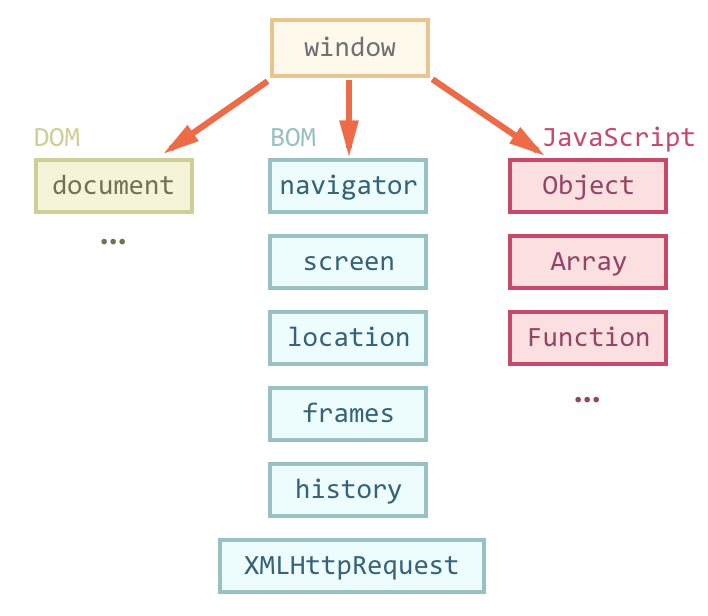

# Окружение: DOM, BOM и JS

## Информация



::: tip Определение

- **window** - окно браузера. С одной стороны является глобальным объектом в JavaScript, с другой – содержит свойства и методы для управления окном браузера, открытия новых окон, например `window.open(...)`
- **document** - документ, который загружается в браузер. Глобальный объект даёт возможность взаимодействовать с содержимым страницы

:::

### Window состоит из

1. `DOM` - объектная модель документа
2. `BOM` - объектная модель браузера
3. Глобальные переменные, объекты, функции и т.д.

## window.document

```js
const a = window.document; // HTML документ
document.write("Текст"); // Вывод на экран
```
