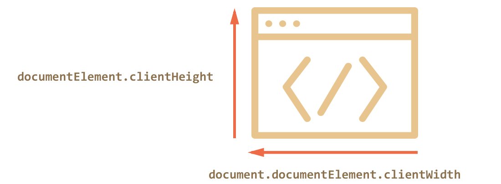

# Размеры и прокрутка страницы

## Информация

```js
let a = document.documentElement.clientWidth; // Ширина минус прокрутка
let a = window.innerWidth; // Вся ширина окна
```

### `clientWidth` и `clientHeight`

::: tip Определение

- **clientWidth/Height** - ширина/высота видимой области окна

:::

- Если есть полоса прокрутки, возвращают именно ширину/высоту внутри неё, доступную для документа



```js
const a = document.body.clientWidth; // Ширина документа (если body margin:0, совпадает с innerWidth)
const a = document.body.clientHeight; // Высота документа (по контенту body)

const a = document.documentElement.clientWidth; // Ширина документа (совпадает с innerWidth)
const a = document.documentElement.clientHeight; // Высота документа (совпадает с innerHeight)
```

### `innerWidth` и `innerHeight`

::: tip Определение

- **innerWidth/Height** - хранят текущий размер окна браузера

:::

- Если есть полоса прокрутки, игнорируют её наличие

```js
const a = window.innerWidth; // Ширина
const a = window.innerHeight; // Высота
```

## Получение текущей прокрутки

- Свойства можно только читать, а менять нельзя

::: danger

**`window.pageYOffset`** - текущая прокрутка сверху

:::

::: danger

**`window.pageXOffset`** - текущая прокрутка слева

:::

## Изменение прокрутки: scrollTo, scrollBy, scrollIntoView

- Чтобы прокрутить страницу при помощи JavaScript, её DOM должен быть полностью загружен

::: danger

**`window.scrollBy(x, y)`** - прокручивает страницу относительно текущих координат

> - `x` - координата
> - `y` - координата

:::

::: danger

**`window.scrollTo(pageX, pageY)`** - прокручивает страницу к указанным координатам относительно документа. Абсолютные координаты. Эквивалентен установке свойств scrollLeft/scrollTop. Координаты (0,0) - прокрутка в начало документа

> - `pageX` - координата
> - `pageY` - координата

:::

::: danger

**`elem.scrollIntoView(top)`** - вызывается на элементе и прокручивает страницу так, чтобы элемент оказался вверху, если параметр top равен true, и внизу, если top равен false. Причем, если параметр top не указан, то он считается равным true

> - `top` - параметр: true (элемент вверху); false (элемент внизу)

:::

## Примеры

### Ширина/высота страницы с учётом прокрутки

- `documentElement.scrollWidth/scrollHeight` работает некорректно

```js
const scrollHeight = Math.max(
  document.body.scrollHeight,
  document.documentElement.scrollHeight,
  document.body.offsetHeight,
  document.documentElement.offsetHeight,
  document.body.clientHeight,
  document.documentElement.clientHeight,
);
alert("Высота с учетом прокрутки: " + scrollHeight);
```
