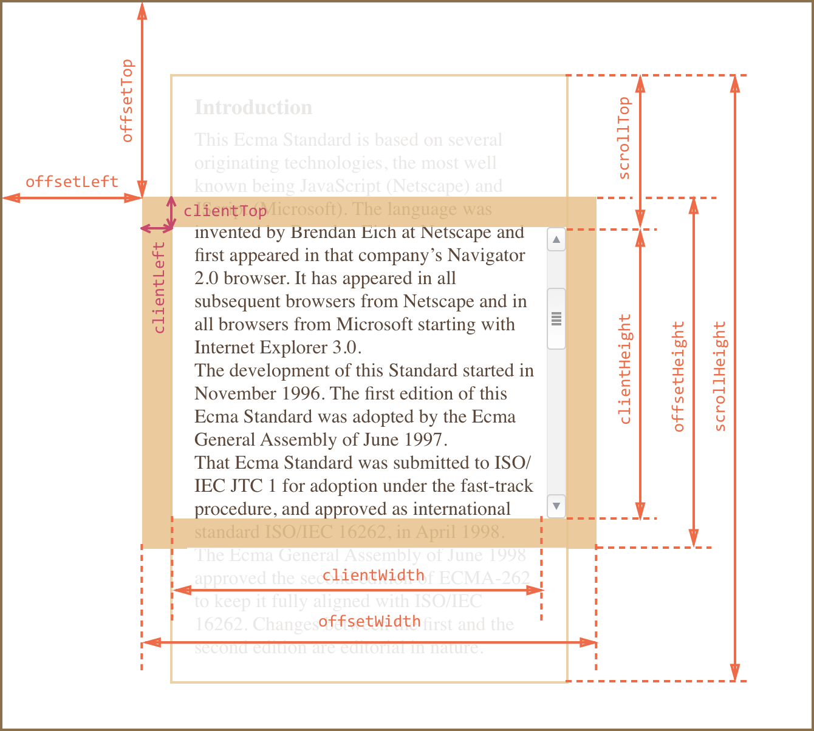
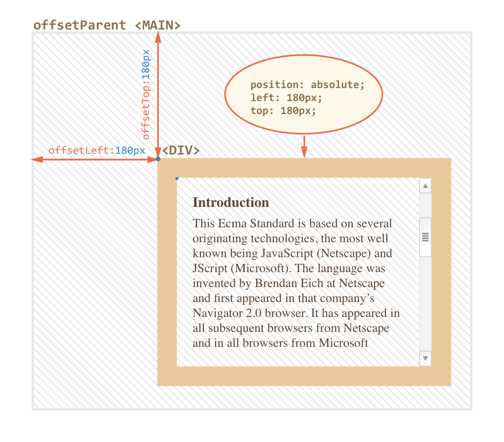
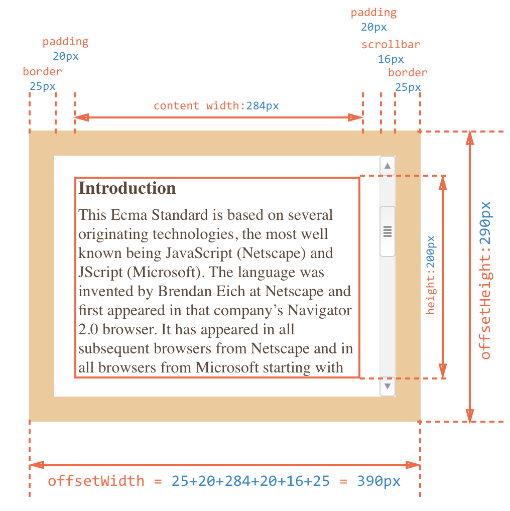
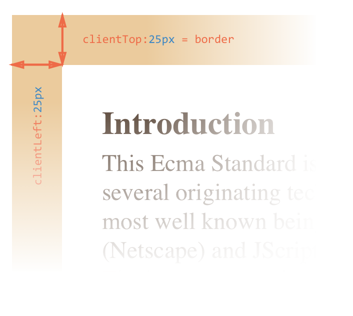
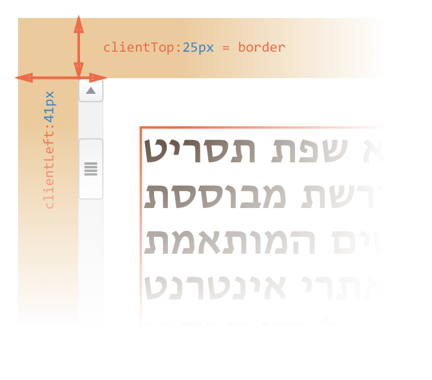
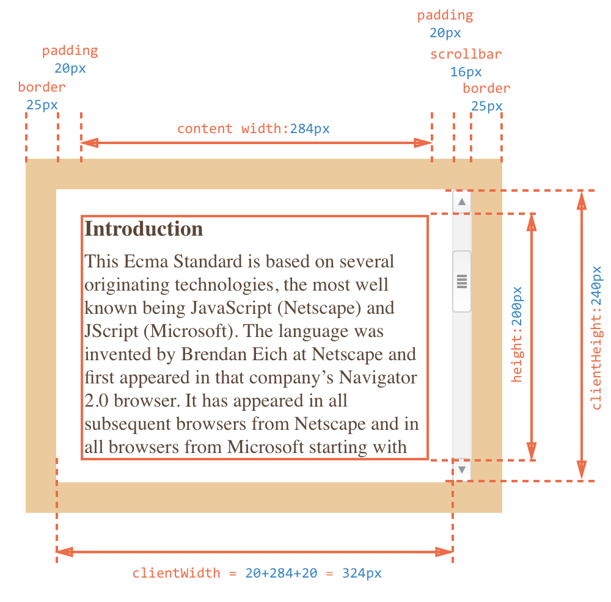
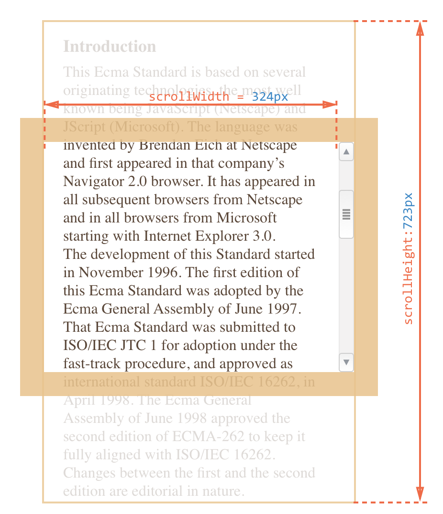
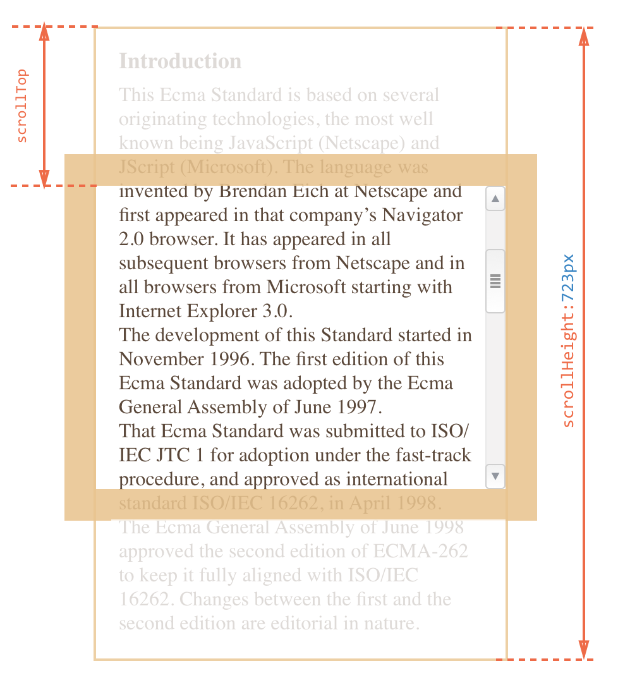

# Размеры и прокрутка элементов

## Информация

<v-two>
<template #first>

**offset**

- `offsetParent` - «родитель по дереву рендеринга» – ближайшая ячейка таблицы, body для статического позиционирования или ближайший позиционированный элемент для других типов позиционирования
- `offsetLeft/offsetTop` - позиция в пикселях левого верхнего угла блока, относительно его offsetParent
- `offsetWidth/offsetHeight` - «внешняя» ширина/высота блока, включая рамки

</template>
<template #last>

**client**

- `clientLeft/clientTop` - отступ области содержимого от левого-верхнего угла элемента. Если операционная система располагает вертикальную прокрутку справа, то равны ширинам левой/верхней рамки, если же слева (ОС на иврите, арабском), то clientLeft включает в себя прокрутку
- `clientWidth/clientHeight` - ширина/высота содержимого вместе с полями padding, но без полосы прокрутки

**scroll**

- `scrollWidth/scrollHeight` - ширина/высота содержимого, включая прокручиваемую область. Включает в себя padding и не включает полосы прокрутки
- `scrollLeft/scrollTop` - ширина/высота прокрученной части документа, считается от верхнего левого угла

</template>
</v-two>

::: tip Определение

- **Метрики** - ряд свойств у элементов существует, содержащих их внешние и внутренние размеры

:::

- Метрики, в отличие от свойств CSS, содержат числа, всегда в пикселях и без единиц измерения на конце



## offset

### `offsetParent`

- В **offsetParent** находится ссылка на родительский элемент в смысле отображения на странице
- Когда браузер рисует страницу, то он высчитывает дерево расположения элементов, иначе говоря «дерево геометрии» или «дерево рендеринга», которое содержит всю информацию о размерах
- При этом одни элементы естественным образом рисуются внутри других. Но, к примеру, если у элемента стоит `position:absolute`, то его расположение вычисляется уже не относительно непосредственного родителя `parentNode`, а относительно ближайшего позиционированного элемента (т.е. свойство position которого не равно static), или `BODY`, если такой отсутствует
- Получается, что элемент имеет в дополнение к обычному родителю в DOM – ещё одного _«родителя по позиционированию»_, то есть относительно которого он рисуется. Этот элемент и будет в свойстве _offsetParent_

### `offsetLeft` и `offsetTop`



- **offsetLeft/Top** - свойства задают смещение относительно _offsetParent_
- В примере внутренний `<div>` имеет DOM-родителя `<form>`, но offsetParent у него `<main>`, и сдвиги относительно его верхнего-левого угла будут в offsetLeft/Top:

```html
<main style="position: relative">
  <form>
    <div id="example" style="position: absolute; left: 180px; top: 180px">
      ...
    </div>
  </form>
</main>
```

### `offsetWidth` и `offsetHeight`



- **offsetWidth/Height** - содержат «внешнюю» ширину/высоту элемента, то есть его полный размер, включая рамки border
- `offsetWidth = 390` - внешняя ширина блока, её можно получить сложением CSS-ширины (300px, но её часть на рисунке выше отнимает прокрутка, поэтому 284 + 16), полей (2\*20px) и рамок (2\*25px)
- `offsetHeight = 290` - внешняя высота блока

**Метрики для невидимых элементов равны нулю**

- Координаты и размеры в JavaScript устанавливаются только для видимых элементов
- Для элементов с `display:none` или находящихся вне документа дерево рендеринга не строится. Для них метрики равны нулю. `offsetParent` для таких элементов null

## client

### `clientLeft` и `clientTop`

- **clientLeft/Top** - отступ внутренней части элемента от внешней. Обычно это только `border`, но если документ располагается справа налево (операционная система на арабском языке или иврите) полоса прокрутки в этом случае находится слева, и тогда свойство clientLeft включает в себя еще и ширину полосы прокрутки

<v-two>
<template #first>

- `clientLeft = 25` - ширина левой рамки
- `clientTop = 25` - ширина верхней рамки



</template>
<template #last>

- `clientLeft = 41` - ширина левой рамки + полоса прокрутки
- `clientTop = 25` - ширина верхней рамки border



</template>
</v-two>

### `clientWidth` и `clientHeight`

- **clientWidth/Height** - размер элемента внутри рамок `border`. Включают в себя ширину содержимого (не CSS-ширина) `width` вместе с полями `padding`, но без прокрутки
- Если _padding_ нет, то clientWidth/Height в точности равны размеру области содержимого, внутри рамок и полосы прокрутки

clientWidth = ШиринаСодержимого + Padding - Прокрутка



## scroll

### `scrollWidth` и `scrollHeight`

- **scrollWidth/Height** - аналоги clientWidth/clientHeight, но с учетом прокрутки
- Свойства _clientWidth/clientHeight_ относятся только к видимой области элемента, а _scrollWidth/scrollHeight_ добавляют к ней прокрученную (которую не видно) по горизонтали/вертикали



- `scrollHeight = 723` - полная внутренняя высота, включая прокрученную область
- `scrollWidth = 324` - полная внутренняя ширина, в данном случае прокрутки нет, поэтому она равна clientWidth

### `scrollLeft` и `scrollTop`

- **scrollLeft/Top** - ширина/высота невидимой, прокрученной в данный момент, части элемента слева и сверху
- Значения _scrollLeft/scrollTop_ можно изменить, и браузер выполнит прокрутку элемента
- `element.scrollTop = 100`


