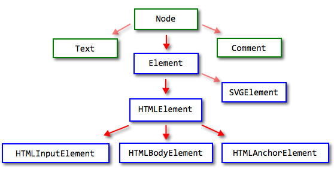

# Узлы

## Информация

- Разные DOM-узлы являются обычными JS объектами различных классов с различными свойствами
- Классы DOM образуют иерархию. Основной объект в ней: Node, от которого наследуют остальные



### Проверка класса

```js
alert(document.body); // [object HTMLBodyElement]

alert(document.body instanceof HTMLBodyElement); // true
alert(document.body instanceof HTMLElement); // true
alert(document.body instanceof Element); // true
alert(document.body instanceof Node); // true
```

## Свойства: tagName, nodeName, nodeType

- `element.nodeType` - тип узла (узел элемента 1 или текстовый узел 3). Доступен только на чтение
- `element.tagName` - название HTML-тега в верхнем регистре. Есть только у элементов _Element_. Если текстовый узел - будет undefined
- `element.nodeName` - название узла (узел элемента или текстовый узел). Определено для любых узлов _Node_. Для элементов оно равно _tagName_, а для не-элементов обычно содержит строку с типом узла

### 1. nodeType - тип узла

1. `Document` - точка входа в DOM
2. `Element Node` (узел-элемент) - HTML-теги. Одни узлы вложены в другие, образуя _дочерние узлы_, за счет которых образована структура дерева
3. `Text Node` (текстовый узел) `#text` - текст внутри элементов. Текстовый узел содержит исключительно строку текста и не может иметь потомков, то есть он всегда на самом нижнем уровне. Пробелы и переводы строки – это тоже текст, полноправные символы, которые учитываются в DOM
4. `Comment Node` (комментарий) `#comment` - комментарий

```js
const a = element.nodeType;
```

```js
// Значения nodeType
ELEMENT_NODE = 1;
ATTRIBUTE_NODE = 2;
TEXT_NODE = 3;
CDATA_SECTION_NODE = 4;
ENTITY_REFERENCE_NODE = 5;
ENTITY_NODE = 6;
PROCESSING_INSTRUCTION_NODE = 7;
COMMENT_NODE = 8;
DOCUMENT_NODE = 9;
DOCUMENT_TYPE_NODE = 10;
DOCUMENT_FRAGMENT_NODE = 11;
NOTATION_NODE = 12;
```

### 2. nodeName и tagName

```js
alert(document.body.nodeName); // BODY
alert(document.body.tagName); // BODY
```

- У браузера есть два режима обработки документа: HTML и XML-режим. Обычно используется режим HTML
- XML-режим включается, когда браузер получает XML-документ через _XMLHttpRequest_ (технология AJAX) или при наличии заголовка `Content-Type: application/xhtml+xml`
- В XML-режиме сохраняется регистр и nodeName может выдать «body» или даже «bOdY» – в точности как указано в документе. XML-режим используют очень редко
