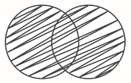
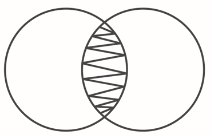
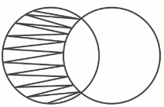

# Коллекции Set и WeakSet (ES6)

## Информация

::: tip Определение

- **Set** - множество, набор значений. Структура данных в которой хранятся уникальные значения

:::

- Нет литеральной формы, создается с помощью конструктора
- Варианты использования: хранение css классов dom элементов
- Является итерируемой структурой данных, можно перебрать с помощью for...of
- Сохраняет порядок элементов в котором они были добавлены

### Отличия WeakSet от Set

- Могут храниться только объекты
- Нет свойства size
- Нет метода clear()
- Не является итерируемым
- Если на объект, который хранится в WeakSet, нет ни одной внешней ссылки, то сборщик мусора удалит этот объект

### Алгоритм проверки

- Каждый раз получая значение, генерирует хэш-функцию. Если она не совпадает с существующей, то это уникальный элемент

## Объявление

```js
const set = new Set(); // Set(0) {}

// Для указания начального значения в конструкторе указывается перебираемый объект
const set = new Set(["button", "active", "small"]); // Set(3) {"button", "active", "small"}

// Буква "t" хранится 1 раз, т.к. в set только уникальные значения
const set = new Set("button"); // Set(5) {"b", "u", "t", "o", "n"}

// set из 1 элемента
const set = new Set(["button"]); // Set(1) {"button"}

// Клонирование set
const set1 = new Set(["button"]); // Set(1) {"button"}
const set2 = new Set(set1); // Set(1) {"button"}
```

## Добавление нового элемента

```js
const set = new Set();
set.add("button");
set.add("active");
set.add("active");
// Set(2) {"button", "active"}

const set = new Set();
set.add("button").add("active").add("active");
```

## Методы

```js
const a = set.size; // Кол-во элементов в set
const a = set.has("button"); // Проверка наличия значения
set.delete("active"); // Удаление элемента
set.clear(); // Очистка set
```

## Set и объекты

```js
const set = new Set();
set.add({ className: "button" });
const a = set.has({ className: "button" }); // false
// В метод add отправляется ссылка на один объект.
// В метод has отправляется ссылка на другой объект

const set = new Set();
const buttonRef = { className: "button" };
set.add(buttonRef);
const a = set.has(buttonRef); // true
```

## values, keys, entries

```js
// Нет метода для получения доступа к конкретному элементу.
// Нет понятия как индекс, поэтому keys возвращает values
console.log(...set); // button active
console.log([...set]); // (2) ["button", "active"] // Преобразование в массив
console.log(Array.from(set)); // (2) ["button", "active"] // Преобразование в массив

console.log(set.values()); // SetIterator {"button", "active"}
console.log(...set.values()); // button active
console.log(...set.keys()); // button active
console.log(...set.entries()); // (2) ["button", "button"] (2) ["active", "active"]
```

### Деструктуризация

```js
const [element1, element2] = set; // Получить первый и второй элемент set
```

## Перебор set

```js
for (let item of set) {
  console.log(item);
}
// button
// active

set.forEach((item, item2, set) => console.log(item, item2, set));
// button button Set(2) {"button", "active"}
// active active Set(2) {"button", "active"}
```

## Операции над множествами

- Нет встроенных методов

```js
const a = new Set([1, 2, 3]);
const b = new Set([3, 4, 5]);
```

### Объединение

<v-two>
<template #first>



- Объединение множеств - множество, содержащее в себе все элементы исходных множеств

</template>
<template #last>

```js
// Set(5) {1, 2, 3, 4, 5}
const union = new Set([...a, ...b]);
```

</template>
</v-two>

### Пересечение

<v-two>
<template #first>



- Пересечение множеств - множество, которому принадлежат элементы которые есть во всех исходных множествах

</template>
<template #last>

```js
// Set(1) {3}
const intersection = new Set([...a].filter((x) => b.has(x)));
```

</template>
</v-two>

### Разность

<v-two>
<template #first>



- Разность множеств - множество в которое входят все элементы первого множества не входящие во второе множество

</template>
<template #last>

```js
// Set(2) {1, 2}
const difference = new Set([...a].filter((x) => !b.has(x)));
```

</template>
</v-two>
