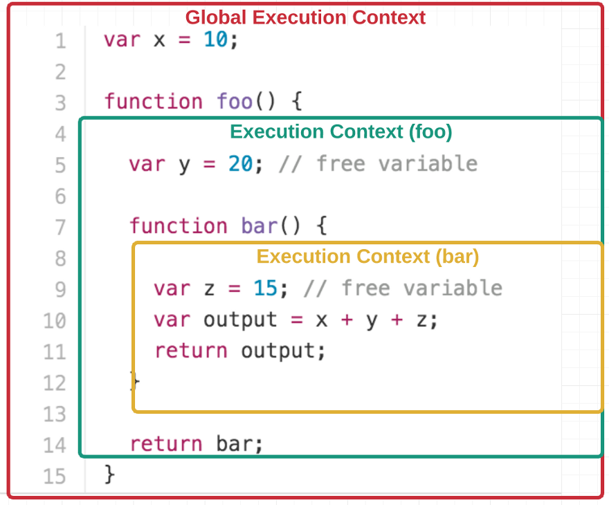

# Контекст: this

## Контекст

::: tip Определение

- **Контекст** - объект, который получит функция на момент выполнения своего кода

:::

```js
function foo() {
  console.log(this);
}

// Глобальный контекст
foo();
// => window || undefined

// Контекст объекта
const obj = { name: "Tony" };
foo.call(obj);
// => { name: 'Tony' }
```

::: tip Определение

- **Контекст выполнения (Execution Context)** - служебная информация, которая соответствует текущему запуску функции. Она включает в себя локальные переменные функции и конкретное место в коде, на котором находится интерпретатор. У каждого вызова функции свой «контекст выполнения» и он всегда разный в зависимости от того как функция была вызвана
- **Контекст вызова функции** - тот объект который ее вызывает

:::

- Контекст бывает либо глобальным, с которого начинается исполнение скрипта, либо контекстом выполнения вызова, который начинается с момента входа в тело функции
- В каждый момент времени активен только один контекст выполнения. Именно поэтому JavaScript называют “однопоточным”, имея в виду, что только одна инструкция исполняется в один момент времени. Типичный браузер отслеживает контексты выполнения с помощью стека



## This

::: tip Определение

- **this** - ссылка на текущий контекст вызова (на текущий объект с которым произошло событие). Определяется в момент вызова функции

:::

- _this_ - обращение к контексту функции. Функция вызывается в контексте объекта, this ссылка на этот объект
- _this_ зависит от того как вызвана функция
- Любая функция может иметь в себе _this_. Если функция использует _this_ - это подразумевает работу с объектом
- _this_ - это текущий объект при вызове «через точку» и новый объект при конструировании через _new_
- _Функции_ не привязаны к своему контексту _this_

### На что указывает _this_

- В глобальном контексте - на глобальный объект
- В функциональном контексте - на контекст, откуда функция вызвана
- В функции, обрабатывающей событие DOM - на DOM элемент, который вызвал событие

### Значение this устанавливается в зависимости от того, как вызвана функция

<v-two>
<template #first>

**1. При вызове функции как метода**

`this = obj`

```js
obj.func(...)
obj["func"](...)
```

**2. При обычном вызове**

`this = window (ES3) /undefined (ES5)`

```js
func(...)
```

</template>
<template #last>

**3. В new**

`this = {} (новый объект)`

```js
new func();
```

**4. Явное указание**

`this = context (явная передача)`

```js
func.apply(context, args)
func.call(context, arg1, arg2, ...)
```

</template>
</v-two>

## 4 способа вызова this

1. `bind`, `call`, `apply`
2. Конструктор `new`
3. Функция
4. Объект
