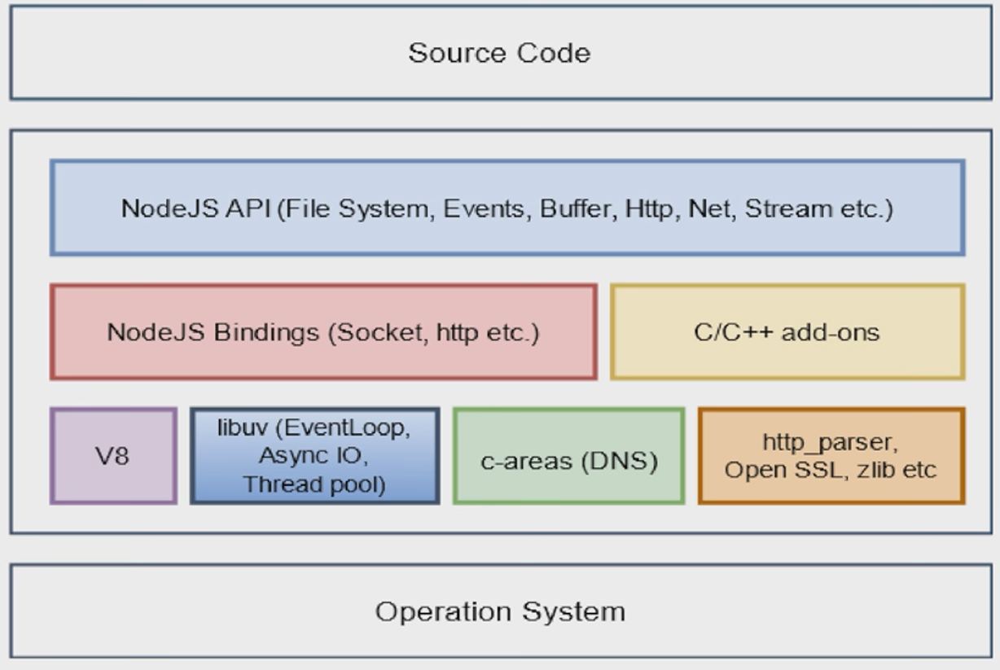

# Структура Node.js

## Информация

- Node.js является Middleware между нашим кодом и ОС

## Общая структура

<v-two text-right>
<template #first>

</template>
<template #last>

- _Node.js API_ - Core JavaScript API + дополнения
- _Node.js Bindings_ (Нативные биндинги) - соединяют JS-код и C/C++ код более низкого уровня

</template>
</v-two>

::: tip Определение

- **libuv** - приносит абстракцию над системным Демультиплексором. Т.к. в каждой системе свой Демультиплексор (Linux, Windows и т.д.)

:::
