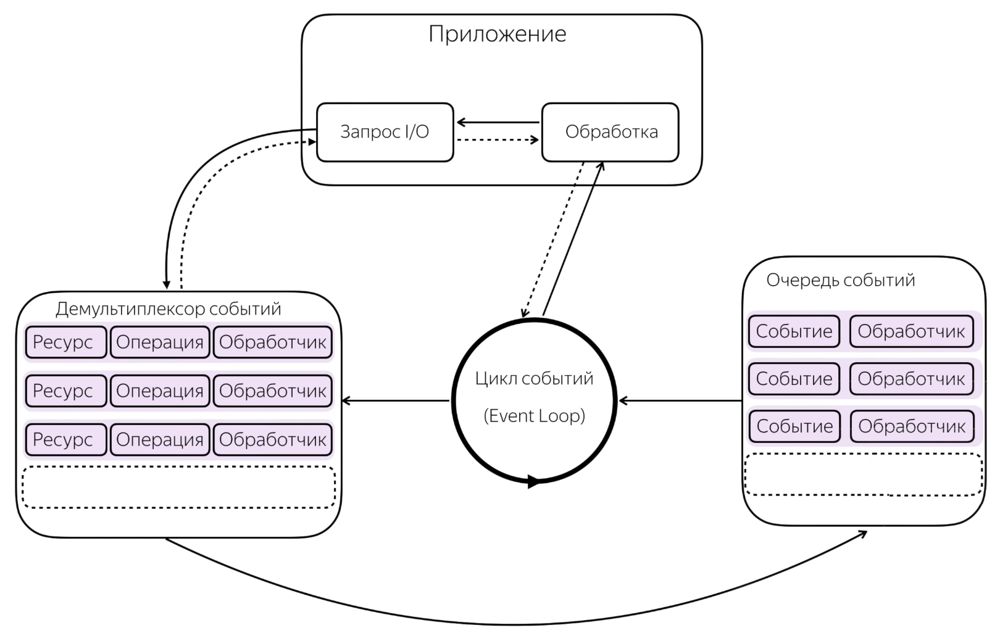
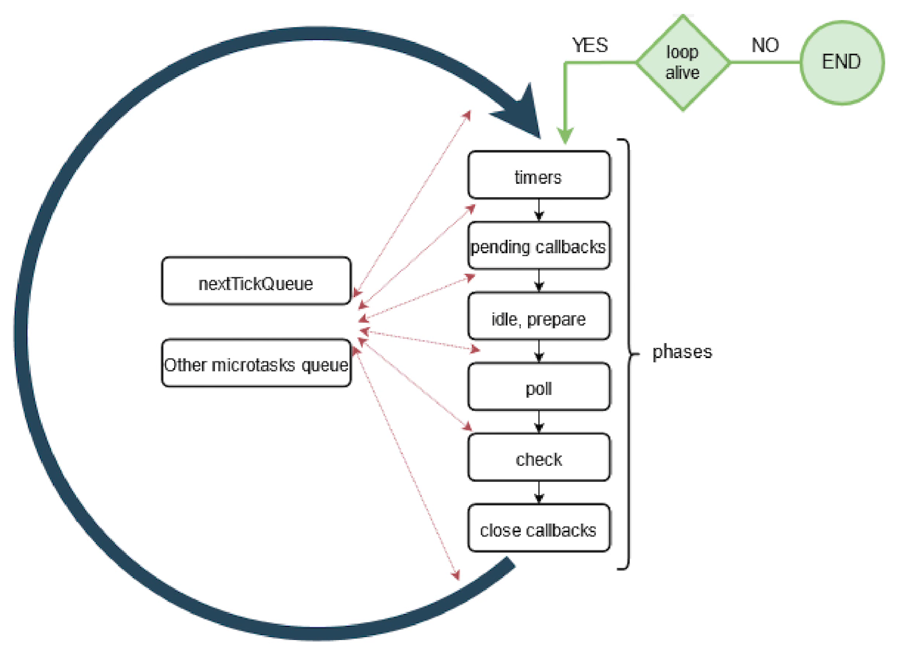

# Event Loop

## Информация

::: tip Определение

- **Event Loop** - позволяет Node.js выполнять асинхронные неблокирующие I/O (Input / Output) операции, несмотря на то, что JS является однопоточным. Путём выгрузки части операций в ядро, если это возможно.
- **I/O** - input/output операции
- **setImmediate** - применяется, чтобы поставить функцию в очередь на выполнение без задержки. У setImmediate один обязательный аргумент – это функция, выполнение которой нужно запланировать (callback)
- **Object.observe()** - позволяет асинхронно отслеживать изменения состояния JavaScript объектов во времени, без использования каких-либо сторонних библиотек

:::

::: warning

- `Object.observe()` не вошёл в стандарт ECMAScript и удалён из V8 и Node.js. Для отслеживания изменений объекта используется `Proxy`

:::

## Event Loop

<v-two text-right>
<template #first>



</template>
<template #last>

**Приложение**

- Формирование запроса I/O
- Обработка callback, поступившего из _Event Loop_

**Демультиплексор событий**

- Регистрация обращений к I/O
- Приём callback, который должен выполниться после запроса
- Возвращение управления обратно в _"Приложение"_

**Очередь событий**

- Приём события, которое произошло
- Когда событие выполнено, то нужно загрузить callback _"Обработчик"_
- Копится очередь событий

</template>
</v-two>

- _libuv_ - приносит абстракцию над системным _Демультиплексором_. Т.к. в каждой системе свой Демультиплексор (Linux, Windows и т.д.)

**Event Loop**

- Event Loop обращается в _"Очередь событий"_, берёт событие, идёт в _"Приложение"_ и вызывает callback _"Обработчик"_
- _"Приложение"_ может выполнить _"Обработчик"_ или запустить новый асинхронный запрос
- При отсутствии событий в _"Очереди событий"_, Event Loop возвращает управление в _"Демультиплексор событий"_
- Программа заканчивается, когда ничего нет в _"Очереди событий"_ и _"Демультиплексоре событий"_

## Event Loop structure

### Наиболее приоритетные очереди (микротаски)

<v-two text-right>
<template #first>



</template>
<template #last>

**1. nextTickQueue**

- Попадают callback, которые добавляются через `process.nextTick()`

**2. Other Microtasks Queue**

- Попадают `Promise`

**3. Object.observe()**

---

- Если Event Loop находится не на фазах, то идёт исполнять приоритетные очереди: _nextTickQueue_ и _Other Microtasks Queue_

</template>
</v-two>

### Фазы

**1. Timers**

- Попадают callback _setTimeout_ и _setInterval_
- Для Libuv setTimeout и setInterval - это одна функция, но у setInterval есть параметр repeat

**2. Pending Callbacks**

- Очередь, куда попадают I/O операции (не все): connection к сети, коллбэки ошибок

**3. Idle, Prepare**

- Нет доступа к этой фазе. Только Event Loop может попасть туда, н-р: перед тем как начинает читать файл, Event Loop может подготовить какие-то данные, то попадает в эту фазу

**4. Poll**

- Попадают I/O операции: начало чтения файла

**5. Check**

- Попадают только setImmediate
- setImmediate применяется, чтобы поставить функцию в очередь на выполнение без задержки. У setImmediate один обязательный аргумент – это функция, выполнение которой нужно запланировать (callback). Этот callback попадает в Check

**6. Close Callbacks**

- Попадают callback вида "close": onClose, socketOnClose и т.д.

## Пример

```js
const fs = require("fs");
```

<v-two fix-right text-right>
<template #first>

```js
console.log("START");
```

</template>
<template #last>

- 1 - Синхронный код

</template>
</v-two>

<v-two fix-right text-right>
<template #first>

```js
setTimeout(() => console.log("setTimeout 1"), 0); // A
```

</template>
<template #last>

- 6 - Этап #1: _Timers_

</template>
</v-two>

<v-two fix-right text-right>
<template #first>

```js
setImmediate(() => console.log("setImmediate")); // B
```

</template>
<template #last>

- 8 - Этап #5: _Check_

</template>
</v-two>

- Этап _Poll_ идет перед _Check_ - Poll выполнится первым, но Callback перейдет на следующий Check
- Это при условии, что идет чтение файла _readFile_, на _writeFile_ будет раньше (TODO: проверить)

<v-two fix-right text-right>
<template #first>

<!-- prettier-ignore -->
```js
fs.readFile(__filename, () => {                              // C
  setTimeout(() => console.log("readFile setTimeout"), 0);   // D
  setImmediate(() => console.log("readFile setImmediate"));  // E
  process.nextTick(() => console.log("readFile Next Tick")); // F
});
```

</template>
<template #last>

- (C) Этап #4: _Poll_
- 9 (F) - Микротаска #1: _nextTickQueue_
- 10 (E) - Этап #5: _Check_
- 11 (D) - Этап #1: _Timers_

</template>
</v-two>

<v-two fix-right text-right>
<template #first>

<!-- prettier-ignore -->
```js
Promise.resolve()
  .then(() => {                                               // G
    console.log("Promise");
    process.nextTick(() => console.log("Promise Next Tick")); // H
  });
```

</template>
<template #last>

- 4 (G) - Микротаска #2: _Other Microtasks Queue_
- 5 (H) - Микротаска #1: _nextTickQueue_

</template>
</v-two>

<v-two fix-right text-right>
<template #first>

```js
process.nextTick(() => console.log("Next Tick")); // I
```

</template>
<template #last>

- 3 - Микротаска #1: _nextTickQueue_

</template>
</v-two>

<v-two fix-right text-right>
<template #first>

```js
setTimeout(() => console.log("setTimeout 2"), 0); // J
```

</template>
<template #last>

- 7 - Этап #1: _Timers_

</template>
</v-two>

<v-two fix-right text-right>
<template #first>

```js
console.log("END");
```

</template>
<template #last>

- 2 - Синхронный код

</template>
</v-two>

::: warning

- Порядок вывода 6-11 не гарантирован: `setTimeout(…, 0)` и `setImmediate()` в основном модуле выполняются в разном порядке (зависит от производительности процесса), а колбэк `fs.readFile` может выполниться как до, так и после таймеров
- Гарантирован порядок 1-5 и порядок внутри колбэка `fs.readFile`: 9 → 10 → 11 (внутри колбэка I/O `setImmediate` всегда выполняется раньше `setTimeout`)

:::
