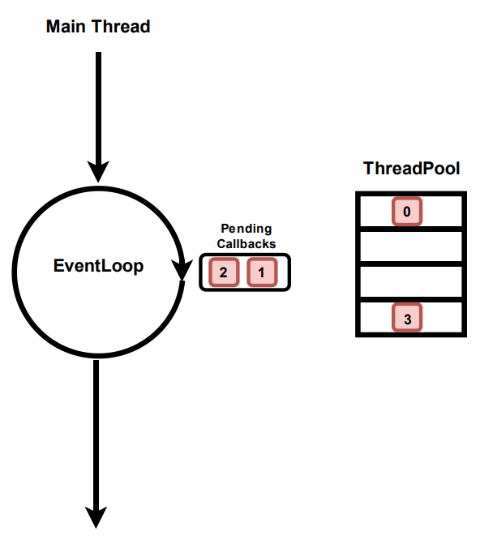

# Thread Pool

## Информация

::: tip Определение

- **Thread Pool** - используется для запуска пользовательского кода и получения уведомления в потоке цикла (происходит возврат обратно в Loop)

:::

## Установка кол-ва потоков

- Можно контролировать количество потоков, установив `process.env.UV_THREADPOOL_SIZE`
- `process.env.UV_THREADPOOL_SIZE == 4` (по умолчанию). Максимальное значение _128_
- Нет смысла устанавливать кол-во потоков большее, чем кол-во ядер в процессоре

::: warning

- Начиная с libuv 1.30.0 (актуальные версии Node.js) максимальное значение `UV_THREADPOOL_SIZE` - 1024

:::

## Схема работы

<v-two text-right>
<template #first>

</template>
<template #last>

1. Часть кода отправляется в Thread Pool
2. В Thread Pool выполняется код
3. Обратно возвращается в основной Thread и попадает в "Pending Callbacks"
4. Event Loop выполняет задачи из "Pending Callbacks"

</template>
</v-two>
